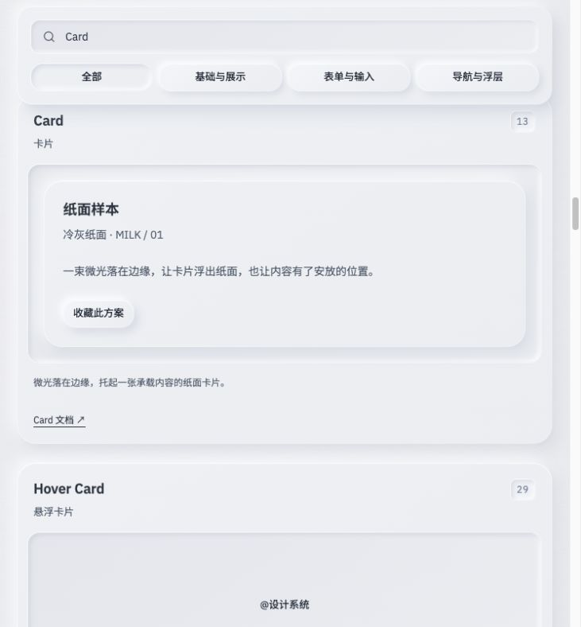
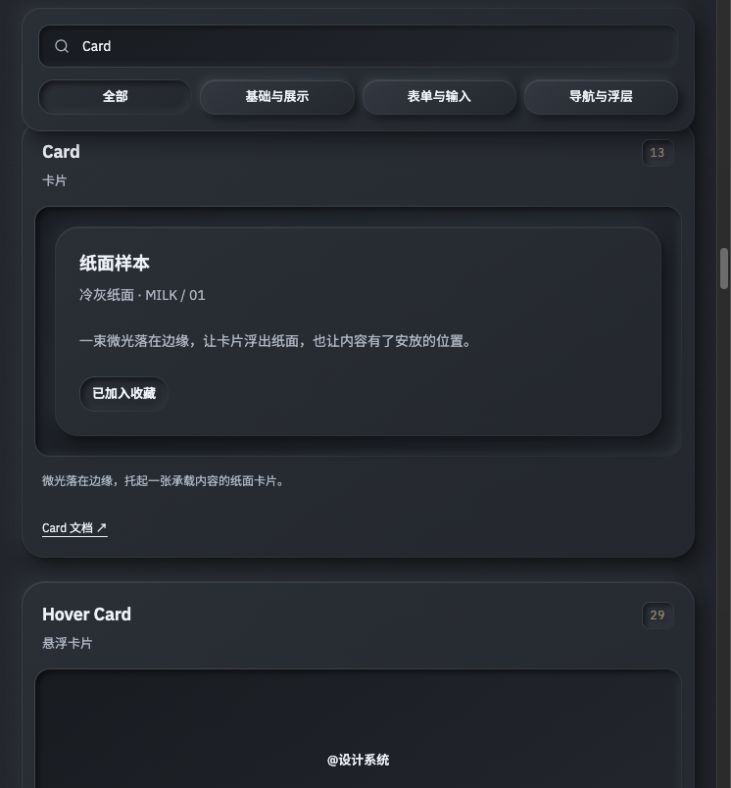

# Milkstone

**纸上成形，触感有度。**

融合前端工程架构、实体感 UI 组件、设计规范、可视化工作台与 Agent Skill 的 Vue Web 设计工具集。

*A tactile Vue design system combining editable UI components, visual workbenches, frontend architecture, and a portable Agent Skill.*

[](LICENSE)
[](https://github.com/TheCrookedMan/milkstone/actions/workflows/ci.yml)
[](https://vuejs.org/)
[](docs/shadcn-registry-source.json)

[国内体验](https://milkstone.dipp.cc/) · [GitHub Pages](https://thecrookedman.github.io/milkstone/) · [GitHub 仓库](https://github.com/TheCrookedMan/milkstone) · [Gitee 国内镜像](https://gitee.com/theCrookedMan/milkstone) · [快速开始](#快速开始) · [组件与工作台](#组件与工作台) · [设计规范](#设计规范) · [Agent Skill](#agent-skill) · [下载技能包](https://github.com/TheCrookedMan/milkstone/releases/latest)

## 为什么叫 Milkstone

**Milk** 对应纸白与牛奶乳白、柔和高光与细腻表面，**Stone** 对应石墨暗色、实体厚度与稳定的按压反馈。白色、黑色、乳白三种风格共享一套材料角色、布局和交互规则。

Milkstone 将可运行的页面、可编辑的组件源码和可供 Agent 复用的规范放在同一个工程中。你可以浏览组件、复制领域工作台，也可以安装技能，让 Agent 按相同的设计语言完成后续页面。

## 界面预览

下图为仓库中真实运行的 Card、按钮、搜索框和分类导航。三种风格保持相同的凸起与凹槽关系。下图展示纸白和石墨；新增乳白可在在线体验的“界面风格”中选择。

| 纸白 / Light | 石墨 / Dark |
| --- | --- |
|  |  |

## 组件与工作台

| 模块 | 已实现能力 |
| --- | --- |
| **shadcn-vue 组件目录** | 70 项交互演示，支持中英文搜索、分类筛选；按钮、Card、表单、Tabs、表格、日历、导航、浮层等共享材质与排版规范 |
| **实体控件** | 刻度旋钮、蚀刻标签、胶囊按键、凹槽导航、开关及轻压回弹反馈 |
| **空状态插图** | 自定义 Prompt 经大模型生成 Hairline 等距线稿、明暗预览与自包含交互 HTML；已有图可保存到本浏览器图库、直接复用及 JSON 导入导出；生成需另行配置可选 API 服务 |
| **数据图表** | ECharts 折线与柱形切换、系列显隐、数据明细；组件目录另含 Unovis Chart 和 TanStack Data Table |
| **关系与星空** | 神经网络、章鱼图、星空三种模式；沿路径移动的电流光点、轨道、自转、公转及五类可配置星体皮肤 |
| **园区雷达** | 原生 Canvas 2D 柔焦等距建筑、粒子、XYZ 坐标、每五秒一圈的扫描和楼层亮起效果 |
| **节点工作流** | Vue Flow 节点拖动、连线、参数编辑、JSON 导入导出及本地拓扑模拟 |
| **Agent Skill** | 设计、架构、交互和验收规范，可复用源码、三个独立示例以及技能安装与导出工具 |

70 项组件以 **2026-10-09 核对的 shadcn-vue 官方目录**为基准；本地来源、版本与适配方式记录在[组件来源清单](docs/shadcn-registry-source.json)中。

星体使用程序生成的 WebGL 球面材质，并提供 Canvas 2D 回退。工作流支持明确的 **ComfyUI Workflow JSON 0.4 子集**，详见[格式与接入范围](skills/milk-white-web-design/references/workflow-editor.md)。

空状态组件可根据用户 Prompt 调用大模型，按 Hairline Create 的图形接口生成等距线稿。服务只生成图形源码，固定引擎和交互页面保持原样；通过静态校验后，由隔离绘制器生成明暗预览。满意的图形可保存复用，选择已有图无需再次调用模型。附带空托盘和已保存图库不依赖生成服务；新图生成需配置模型服务，不能用静态站点代替模型接口。接入、保存与验收范围见[空状态插图规范](skills/milk-white-web-design/references/empty-state-illustrations.md)。

## 快速开始

完整开发与测试建议使用 **Node.js 24.10.0** 和 **pnpm 10.18.3**，与本项目验证环境及 CI 一致。工程声明的运行基线见 [package.json](package.json)。

```bash
git clone https://github.com/TheCrookedMan/milkstone.git
cd milkstone
pnpm install --frozen-lockfile
pnpm dev
```

国内用户也可从 Gitee 克隆相同源码：`git clone https://gitee.com/theCrookedMan/milkstone.git`。

打开 [http://127.0.0.1:4340/](http://127.0.0.1:4340/)。开发和预览服务默认监听 `0.0.0.0:4340`，同一局域网中的电脑可使用启动终端显示的 Network 地址访问。

仅需本机访问时：

```bash
pnpm dev --host 127.0.0.1
```

| 本地入口 | 内容 |
| --- | --- |
| `/#/#stack` | 技术栈与技能能力 |
| `/#/#shadcn` | 70 项基础组件 |
| `/#/#empty-states` | 空状态插图与交互示例 |
| `/#/#instruments` | 实体控件 |
| `/#/#charts` | 数据图表 |
| `/#/#relations` | 关系与星空 |
| `/#/#campus` | 园区雷达 |
| `/#/#workflow` | 节点工作流 |
| `/#/#theme` | 白色、黑色与乳白设计规范 |
| `/#/guide` | 使用指南 |

### 可选：Prompt 生成空状态插图

默认页面与已有图库可以独立运行。需要生成新图时，先复制服务配置：

```bash
cp server/.env.example .env.hairline
```

在根目录 `.env.hairline` 填入自己的 DeepSeek API 密钥和单独设置的服务访问令牌：

```dotenv
HAIRLINE_MODEL_BASE_URL=https://api.deepseek.com
HAIRLINE_MODEL_API_KEY=your-deepseek-api-key
HAIRLINE_MODEL=deepseek-flash
HAIRLINE_ACCESS_TOKEN=your-private-service-access-token
```

默认端点与模型依据 [DeepSeek 官方接入文档](https://api-docs.deepseek.com/zh-cn/)；也可自定义其他 OpenAI 兼容服务和模型。项目不提供公共密钥。填好后在另一个终端启动生成服务，命令会自动加载根目录 `.env.hairline`：

```bash
pnpm hairline:serve
```

服务默认监听 `127.0.0.1:4341`，Vite 开发服务将 `/api/hairline/` 代理到该地址。打开空状态展区，服务 URL 使用完整 API 基址，例如 `http://127.0.0.1:4340/api/hairline`，填写服务访问令牌，再描述物件、缺席的内容及指针如何回应，生成、预览和保存。模型密钥只放服务端，页面中的访问令牌用于保护生成服务，与模型密钥不同；公开部署还需配置允许来源和 HTTPS。完整变量、接口与技能包运行方式见[Hairline 生成服务](skills/milk-white-web-design/references/hairline-generation-service.md)。

### 检查与构建

```bash
pnpm typecheck
pnpm test
pnpm build
pnpm preview
```

`pnpm dev` 和 `pnpm build` 会先自动同步独立组件目录并生成技能包。生产静态文件输出到 `dist/`；使用 Hash 路由。发布到仓库子路径时，构建需指定相应的 `base`。

### 在线发布

公共演示使用 [GitHub Pages](https://thecrookedman.github.io/milkstone/)，由 GitHub Actions 在 `main` 更新后构建发布，无需部署密钥。构建命令为 `pnpm run build --base=/milkstone/`，技能包与页面一起生成。仓库同时保留可选的 Vercel 配置，操作与验收步骤见 [部署说明](docs/deployment.md)。

[国内演示](https://milkstone.dipp.cc/) 部署在由 1Panel 管理的 OpenResty 静态站点，采用域名根路径构建、HTTPS 与证书自动续签。更新时需重新构建并上传完整静态产物；推送 GitHub 或 Gitee 不会自动发布到此服务器。操作步骤见 [1Panel 部署说明](docs/deployment.md#1panel-自有服务器)。

源码同时发布到 [Gitee 个人仓库](https://gitee.com/theCrookedMan/milkstone)。Gitee Pages 已下线，Gitee 镜像提供源码托管；其他托管选择与镜像同步方法见 [部署说明](docs/deployment.md#gitee-国内镜像与国内站点)。

## 技术架构

| 层级 | 技术与职责 |
| --- | --- |
| 工程基础 | Vue 3、TypeScript、Vite 8、Tailwind CSS 4、Vue Router |
| UI 与可访问交互 | 本地 shadcn-vue 源码、Reka UI、VueUse、Lucide |
| 数据与图形 | ECharts、Unovis、TanStack Table、SVG、Canvas 2D、原生 WebGL |
| 可选线稿生成 | 独立 Node.js API、OpenAI 兼容模型、Hairline 固定引擎与静态校验、隔离预览、服务缓存与本浏览器图库 |
| 节点编辑 | Vue Flow 与独立的 ComfyUI 格式适配器 |
| 状态与动效 | Vue 响应式状态、已注册的 Pinia 入口、主题控制器、共享按压、悬浮波纹、焦点循光及滚动渐入控制器，GSAP 按需编排 |
| Agent 交付 | SKILL.md、参考规范、可复用资产、Node.js 安装器、ZIP / tar.gz 归档 |

```text
milkstone/
├── src/
│   ├── app/                         应用壳
│   ├── pages/                       落地页与指南
│   ├── router/                      Hash 路由
│   ├── components/ui/               shadcn-vue 本地组件源码
│   ├── components/shadcn-gallery/   基础组件交互示例
│   ├── data/                        组件目录与技术栈
│   └── styles/                      共享材质、间距和字阶
├── skills/milk-white-web-design/
│   ├── SKILL.md
│   ├── references/                  设计、架构、交互、接入与验收
│   └── assets/
│       ├── components/              五个领域工作台及其支持模块
│       ├── vue-panel/               最小 Vue 示例
│       ├── component-lab/           领域组件沙盒
│       └── shadcn-catalog/          独立基础组件目录
├── bin/                             本地 CLI
├── server/                          可选 Hairline 模型服务与固定运行时
├── lib/                             安装与归档
├── scripts/                         源码同步、打包与校验
├── tests/                           安装器、工作流、主题和按压测试
├── docs/                            接入说明、来源和预览
└── public/licenses/                 第三方许可文本
```

领域组件以技能资产中的文件为开发来源，落地页直接引用。基础组件以根工程 `src/` 为开发来源，打包时同步到独立 `shadcn-catalog`，避免演示与交付内容分叉。

## 设计规范

- **材料与光照**：冷灰纸白 / 石墨暗色 / 牛奶乳白，轻微纸纹；左上受光、右下柔影。Card 浮起，输入框和 Tabs 槽位内收，选中拨片浮起。
- **间距**：使用 4、8、12、16、24、32px 节奏；标签与控件 8px，独立分区 24px，操作区 12px。
- **字阶**：辅助文字 12px、标签与普通按钮 13px、正文 14px、次标题 16px、Card 标题 18px、弹层标题 20px。
- **尺寸**：普通控件 44px、small 36px、图标按钮 40px、Tabs 拨片 40px；日历与嵌入控件保留专用密度。
- **渐入**：标题、卡片和工作台随视区逐层显现，700ms 淡入并轻移 18px；同组错峰 80ms，延迟上限 240ms。
- **按压**：100ms 按下、至少 112ms 反馈、420ms 平稳回位；普通按钮下沉 2px、缩放至 0.975。
- **三种风格**：白色清爽、黑色沉静、乳白温润；共用布局、层级与状态规则，按材料角色切换配色，保留相同的凸起和凹槽感。
- **轻触与焦点**：按钮悬浮时表面微波轻轻荡开，按下后阻尼回位；仅输入框焦点以低饱和雾蓝、青玉与淡紫流光沿已有边缘游走，首尾自然渐隐；复合输入只在编辑器聚焦时亮起，内部按钮不触发。其他元素不新增焦点边框，原有材质与选中状态保持。保留 Reka 的键盘、ARIA 和焦点管理，输入框支持减少动态效果及静态边界回退。

乳白以 `#f4f1ea` 牛奶柔白为基底，`#fbf9f4` 凸面与 `#e9e4da` 凹槽形成柔和层次，搭配暖白高光、浅暖灰投影与深灰褐文字。Card 与按钮使用范围更小、更凝实的投影和贴边接触影，让表面更清楚地浮起；组件的间距、字阶或阻尼保持一致。

详细说明：[设计规范](skills/milk-white-web-design/references/design-system.md) · [三种主题](skills/milk-white-web-design/references/theme-modes.md) · [交互与动画](skills/milk-white-web-design/references/motion-and-network.md) · [组件目录规范](skills/milk-white-web-design/references/shadcn-catalog.md)。

## Agent Skill

项目公开名称为 **Milkstone**；现有 **`milk-white-web-design` Skill ID、CLI 文件名和归档名保持兼容**。安装器在用户主动执行时写入目标目录，支持预演，默认拒绝覆盖已有内容；`--replace` 更新时保留备份。

### 安装到目标项目

先进入你需要开发的业务项目，再执行本仓库中的 CLI：

```bash
cd /path/to/your-project

# Codex 项目技能
node /path/to/milkstone/bin/milk-white-web-design.mjs install --agent codex --project

# Claude Code 项目技能
node /path/to/milkstone/bin/milk-white-web-design.mjs install --agent claude-code --project

# 其他兼容 SKILL.md 的宿主：明确指定技能目录
node /path/to/milkstone/bin/milk-white-web-design.mjs install --target /path/to/skills
```

可以先添加 `--dry-run` 查看目标，个人安装可使用 `--global`。项目路径分别为 `.agents/skills/` 与 `.claude/skills/`。

安装后在支持的 Agent 中调用：

```text
$milk-white-web-design 为我的产品实现纸感界面，支持白色、黑色、乳白主题与实体交互。
```

ChatGPT 桌面插件注册、其他宿主路径与实际验证范围见 [Agent 接入说明](docs/agent-installation.md)。文件写入与宿主实际启用分别验证。

### 导出技能包

在 Milkstone 仓库根目录执行：

```bash
pnpm skill:pack
```

生成内容一致的三个归档：

```text
public/milk-white-web-design.skill
public/milk-white-web-design.skill.zip
public/milk-white-web-design.tar.gz
```

也可以指定输出位置：

```bash
node bin/milk-white-web-design.mjs export --format skill --out milk-white-web-design.skill
node bin/milk-white-web-design.mjs export --format zip --out milk-white-web-design.skill.zip
node bin/milk-white-web-design.mjs export --format tgz --out milk-white-web-design.tar.gz
```

可从 [GitHub Releases](https://github.com/TheCrookedMan/milkstone/releases) 下载构建后的技能包。目前使用仓库内 CLI，尚未发布 npm 包。

### 独立运行示例

将技能的 **整个 `assets/` 目录**复制到工作目录，再运行对应示例，保留组件和令牌的相对路径：

```bash
# 在复制后的 assets 目录中
cd component-lab
pnpm install --frozen-lockfile
pnpm dev
```

`shadcn-catalog/` 已包含独立运行所需源码，也可单独复制后使用 pnpm。最小 `vue-panel/` 示例使用 `npm ci` 与 `npm run dev`。请在工作副本中安装依赖，保持技能资产目录便于复用和打包。

## 当前范围

页面中的表单、收藏、星体配置与工作流用于本地交互演示，未连接业务后端。主题选择与用户保存的线稿图库保存在当前浏览器；图库可通过 JSON 导出与导入迁移，不等同于账号云同步。

Prompt 生成线稿是真实模型接口能力，需要自行配置可选 Node 服务及模型提供方；静态 GitHub Pages 和静态 1Panel 站点本身不运行模型。未配置、请求失败或图形校验失败时显示实际错误，不用预设模板假装生成成功。生成结果标记为 `validation: "static"`，不代表已经通过 Hairline 原技能的八画面视觉验收。

工作流不包含 ComfyUI 服务、模型权重或真实图像生成；不支持 API prompt 格式及未声明的工作流版本。神经图呈现关系示例，园区场景使用原创演示建筑。Pinia 已注册，具体业务 store 可按需增加；Three.js / TresJS 是可选扩展路线。

本仓库提供源码、技能分发与 [在线演示](https://thecrookedman.github.io/milkstone/)。验证范围与已知限制见 [验证记录](docs/verification.md)。

## 参与贡献

欢迎通过 Issue 描述场景或通过 Pull Request 改进组件。开发来源、同步要求和提交前检查见 [贡献指南](CONTRIBUTING.md)。

## 许可与来源

本项目代码与文档采用 [MIT License](LICENSE)。第三方组件、字体和依赖保留各自版权及许可，包括 shadcn-vue 的 MIT、字体 OFL、ECharts 的 Apache-2.0，以及 GSAP 的独立许可。

[第三方声明](public/third-party-notices.md) · [项目来源与许可范围](LICENSE-NOTICE.md) · [技能来源说明](skills/milk-white-web-design/references/source-and-license.md)。
