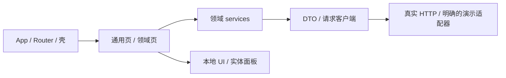

# 前端技术架构

## 采用规则与基线

新项目默认 Vue 单页应用，PC／H5 共用壳、令牌和服务边界。来自附件的技术和工程方法保留；商家／KA 角色、72 个功能、业务前缀、演示会话、Mock 交付范围不构成新产品需求。后端 Rust／其他语言通过 DTO 和接口接入。

既有项目仅套用视觉时保持框架；明确要求本技术栈才迁移。以下基于附件 2026-10-06 架构，并反映当前组件接入，非永远最新。创建时核对 registry、Node engines 和 peer，既有项目不无理由整体升级。

| 领域 | 基线 |
| --- | --- |
| 框架／类型 | Vue 3.5.43、TypeScript 5.9.3、vue-tsc 3.1.4 |
| 路由／状态 | Vue Router 4.5.1、Pinia 3.0.4 |
| 构建 | Vite 8.3.0、@vitejs/plugin-vue 6.0.9、Node ≥22.12、ESM；同时满足实际 Vite engines |
| 样式 | Tailwind CSS 4.3.3、@tailwindcss/vite 4.3.3 |
| 组件 | shadcn-vue 本地源码、Reka UI 2.11.0（当前 Drawer 所需） |
| 工具 | @vueuse/core 14.4.0、class-variance-authority 0.7.1、clsx 2.1.1、tailwind-merge 3.3.1 |
| 图标 | lucide-vue-next 1.0.0，统一 Icon 和显式映射 |
| 动画 | 原生 IntersectionObserver + CSS 入场、委托按压、焦点边框与悬浮波纹控制器；GSAP 3.15.0、Vue Transition 按需使用 |
| 字体 | @fontsource-variable/noto-sans-sc 5.3.0、@fontsource/ibm-plex-sans 5.3.0 |
| 可选 3D | @tresjs/core 5.9.0、three 0.186.0 |
| 可选脚本 | tsx 4.23.13，Node node:test 或现有测试框架 |

Composition API、script setup lang=ts，TS strict、noEmit、ES2022、Bundler。默认 Router hash，明确具备服务器回退且产品要求正常路径时可 history；不因参考设计引入 Nuxt／SSR／微前端。

当前落地页已采用 shadcn-vue 官方 registry 的本地组件源码，存放在 `src/components/ui/`；它与 Reka UI 2.11.0 共同承接基础交互。组件目录覆盖、独立沙盒、展示编排与主题接入见 [shadcn-vue 组件目录](shadcn-catalog.md)。运行依赖以项目实际 `package.json` 与锁文件为准，不把 shadcn-vue 当作运行时整包导入。

## 分层与组织



```text
src/
  app/                  # 启动与应用壳
  router/               # 路由和导航守卫
  pages/                # 编排
  domains/<domain>/     # 复杂流程、模型、领域组件
  components/ui/        # 可编辑 shadcn-vue 基础组件
  components/material/    # 实体控件与业务面板
  config/               # 简单页面、导航和能力映射
  stores/               # 会话、UI、草稿、未保存状态
  services/             # 业务操作和结果映射
  api/                  # DTO、客户端、错误类型
  transports/           # HTTP；可选 demo/mock
  styles/               # 令牌、Tailwind、全局样式
```

页面展示和调用服务，领域／services 管业务校验与 DTO 映射，客户端管取消、超时、认证和错误归一。通用 UI 不直接 fetch 业务接口，业务组件只接结构化数据与发出选择事件。

重复列表／详情／编辑／反馈可配置驱动；编辑器、跨步骤流程、关系图用独立领域组件，不挤进万能 FeaturePage。权限与工作空间按目标业务定义。

## UI 与动效集成

以下颜色以默认 light 为基准，dark 使用对应深色背景、主题及文本，表面、边框与八类柔影按角色校准颜色和透明度，保持相同光照关系、凸起与凹槽感及交互几何，见 [双模式主题](theme-modes.md)。

Tailwind 4 使用 Vite 插件，入口先 `@import "tailwindcss"` 再引入令牌，需要工具类时用 `@theme inline` 映射，如 `--color-background: var(--milk-canvas)`。milk-* 名称保持兼容，其值遵循 [浅灰柔和拟物设计系统](design-system.md)，shadcn 的 background、card、popover、primary、muted、border、ring、destructive 同源映射。普通实体外框和已有结构边界采用 1px 半透明白边，图片专用 3px 白色 rim；复用 --milk-border-width、--milk-border-color 与 --milk-border-gradient，圆角外框可用 padding-box/border-box，无圆角单边结构线可用同源 border-image。Card 和浮层使用外浮柔影，按钮及选中拨片使用小尺度外浮柔影，输入和 Tabbar 凹槽使用内凹阴影；八类阴影角色以 milk-tokens.css 为参数来源。左上白色高光与右下灰色投影配合灰白表面形成柔和层次。milk-relief 及角色类保留兼容，depth 为 0，不再构造伪元素硬底座或 isolation 结构。文字布局不额外套框，图形内容线保留信息含义。实际聚焦控件在已有边框内显示统一柔和渐变流光，保留正常边框几何与柔影；成功装饰时取消外围 outline 与 ring，未接管时保留可见键盘 outline 回退，见 [焦点规范](design-system.md)。画布为 #e9eaee，纸纹静态且极轻，错误状态通过图标和文字表达。

颜色令牌与 `html[data-theme]` 由源码主题控制器管理，启动调用 `initTheme`，切换调用 `setTheme`；`milk-design-theme` 记住选择，变化派发 `milk-theme-change`。令牌默认定义于 :root；嵌入已有系统时可限定主题容器。Teleport 的 Dialog／Popover 根同样需要主题类或主题化 portal 容器，不能丢失 CSS 变量。保留 Reka 焦点和键盘语义。

ECharts/Unovis 等非 CSS 取色通过同一控制器按文本、网格和数据系列角色适配，避免对已解析 CSS 令牌重复取反。Canvas/WebGL 保持星体、建筑与发光的自然照明，只更新需要主题对比的背景、坐标、轨道和标签；主题变化后重绘已有数据，几何和动画相位保持，不通过整页 filter 替代源码取色。

图标显式映射且未知名称回退，不按用户输入执行模块路径。GSAP 只操作局部 DOM、context 清理，列表／toast／dialog 可用 Vue Transition；连续 Canvas 不触发每帧状态树更新。

页面入场复用 assets/reveal-controller.ts 与 assets/milk-motion.css，在 mount 后调用 initRevealMotion()，以 data-milk-reveal 标记单元素、data-milk-reveal-group 标记直接子项分组。原生 IntersectionObserver 触发一次 700ms 渐显／18px 上移，组内延迟按 80ms 递增并封顶 240ms；MutationObserver 登记异步组件、筛选和路由新增内容，无新增动画依赖。旋转媒体、可拖节点和连续动画保留自身 transform，入场仅施加到包装层。返回清理函数接入卸载与 HMR dispose；键盘聚焦时立即显示，减少动态效果、缺少观察器或清理后内容完整可见，详见 [交互规范](motion-and-network.md)。

按钮触感复用 assets/press-controller.ts 的委托控制器，在 initTheme() 后、mount 前调用 initPressFeedback()，返回清理函数接入卸载与 HMR dispose。统一令牌规定 100ms 按下、至少 112ms 反馈和 420ms 平稳回位，默认位移 2px、缩放 0.975；不延迟业务 click，不让按压覆盖浮层定位、节点拖拽或滑杆行为。两模式共用运动几何，减少动态效果只保留即时材质反馈，详见 [交互规范](motion-and-network.md)。

焦点集成与令牌、入场样式一同引入 assets/milk-focus.css，在应用入口调用一次 assets/focus-controller.ts 的 initFocusBorder()；返回清理函数接入卸载与 HMR dispose。由共享控制器跟随真实焦点、复合输入活动格及 Portal，单个 SVG 装饰贴合边框内侧，不更改业务 DOM 的键盘语义。减少动态效果为静态亮边，forced-colors 使用 Highlight；初始化失败或清理后保留可见键盘 outline，详见 [交互规范](motion-and-network.md)。

悬浮波纹引入 assets/milk-hover.css，在应用入口调用一次 assets/hover-controller.ts 的 initHoverRipple()，返回清理函数接入卸载与 HMR dispose。共享委托覆盖后来挂载的按钮及 Portal，表面扩散不改元素尺寸、原有 transform、按压控制器或业务事件；禁用、触摸及减少动态效果不播放，详见 [交互规范](motion-and-network.md)。

## 状态、接口与一致性

- Pinia 保存会话展示、UI、草稿、未保存状态，后端实体／操作结果由后端或明确查询缓存负责。
- localStorage 草稿按用户／工作空间／对象／schema 隔离。容量、解析和写失败有可见反馈，不假称保存成功。
- DTO 依据真实接口／OpenAPI，未知枚举和未适配操作明确处理，不凭空宣称后端支持。
- demo 可见标记，real 接口失败不回退 Mock。可选 HTTP／embedded Mock 共用合同和规则，但不伪称自动同步。
- 查询用 AbortController + 请求序号／当前对象检查，忽略过时返回。前端取消等待不撤销服务端已执行操作。
- 写操作依照稳定 operationId／后端幂等协议确认。无幂等保证不自动重试支付、发布、删除；长任务查询原任务而非重建。
- loading／empty／partial／error／unavailable／forbidden 明确，刷新失败保留可用旧数据及时间，不把错误变成空列表。
- 路由和菜单过滤仅是体验，真实权限由后端校验。VITE 变量公开，不存服务密钥、账户凭证和私人数据。

## 工程与部署

默认 Vite index.html。附件的 app.html、输出目录、双锁文件是原项目事实而非全局要求。选择一种包管理器及锁文件，提供 dev／typecheck／build，按业务风险添加必要测试。

部署核对 base、hash／history 刷新、动态 import、字体同源路径、CSP。3D 关闭时不下载模型／Three，real 构建不误选 Mock。PC／H5 共用业务数据和动作。

### 示例的运行和接入

复制整个 assets 到设计沙盒，保持 milk-tokens.css 与 vue-panel 相邻，再在复制后的 vue-panel 执行；不在安装目录 npm install，避免污染可分发 skill。

```sh
npm ci
npm run typecheck
npm run build
npm run dev -- --host 127.0.0.1
```

示例是 Vue／Vite／TS 最小视觉沙盒，完整工程依上表补 Router、Pinia、Tailwind、Reka 等实际需要模块。示例使用系统字体，完整应用本地安装字体。

示例是按钮计数与实体面板，状态仅在内存，不含后台。

扩展组件依赖：ECharts 6.0.0 按需模块 + SVG renderer；Vue Flow 1.48.2，兼容 Vue ^3.3.0。两者仅当相应页面需要时引入，组件可异步加载。具体示例和独立沙盒见 component-integration.md。
